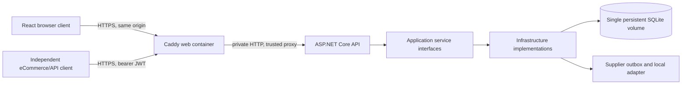

# Architecture and data flow

Happy Inventory is two independently built repositories: this ASP.NET Core .NET 10 API and the [React/TypeScript/Vite web client](https://github.com/Anas-Abukhadir97/happy-inventory-web). The API owns the canonical versioned contract and database migrations; the web pins the contract bytes and generates its TypeScript types. A deployed pair is recorded by separate source commits and immutable image digests in `releases/phase-6-tested.json`.

The web server terminates local HTTPS and forwards `/api/*` to the API over a private Docker network. Production API requests accept forwarded HTTPS information only from the configured proxy IP; the API rejects other plain HTTP requests. Its documented business routes require JWT. The authenticated `/api/v1/health` checks database readiness; local container liveness/readiness probes are loopback-only and stay off the web proxy. Azure topology and public TLS remain undecided until Phase 8 cost approval.

The backend dependency direction is `Domain <- Application <- Infrastructure <- Api composition`. Domain entities and value objects do not depend on EF Core. Controllers call application interfaces; infrastructure owns EF Core/SQLite, migrations, auth persistence, log reading and supplier dispatch. Browser API access passes through typed contract-generated shapes and a fetch wrapper; the UI never supplies role authorization as a security boundary.

An external client logs in with `sessionMode=external` and receives a ten-minute bearer token without a refresh cookie. Browser login uses a same-origin HTTPS Origin plus a CSRF cookie/header pair, then an in-memory access token and rotating Secure HttpOnly refresh cookie. The server checks current account, role and security version on each token use; refresh replay, logout and account changes revoke access. `Admin` manages users and reads logs, `Admin`/`Management` write inventory and supplier requests, and `Auditor` reads permitted inventory/report data.

SQLite stores globally unique active item names, quantities of at least one, money as integer minor units, strong ETag versions and a protected bootstrap administrator. Active users/warehouses/items are soft-deleted to retain audit and integration history. The eCommerce deduction uses a caller-scoped idempotency key and a single SQLite transaction, rejecting a deduction that would leave zero stock. Manual supplier requests commit an order plus outbox record; the worker currently records a local test delivery with bounded retries. It does not contact a supplier.

SQLite requires exactly one API writer on persistent local disk. Named Compose volumes keep the database and logs across restarts; an online SQLite backup and stopped-service restore are verified in CI. High availability, PostgreSQL migration, public ingress, monitoring and rollback belong to the costed Phase 8 deployment decision or later product work.
